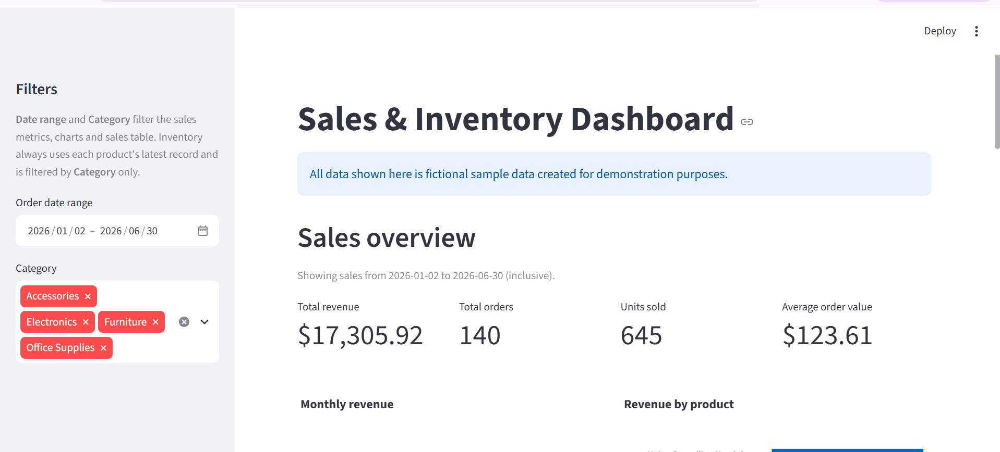

# Sales & Inventory Dashboard

A beginner-friendly analytics dashboard built with Python, Pandas, Streamlit and Plotly. It reads a CSV of sales orders and shows headline sales figures, revenue trends, revenue by product, and the latest recorded stock level for each product, with alerts for products that have fallen below their reorder level.

> **Note:** All data in this project is fictional demonstration data. It does not represent any real business, customer or product.

## Business questions it helps answer

- How much revenue did we make, from how many orders, and how many units did we sell?
- What is the average value of an order?
- How does revenue change from month to month?
- Which products bring in the most revenue?
- How do these numbers change for a specific date range or product category?
- What is the latest recorded stock level for each product?
- Which products are below their reorder level and may need restocking?

## Features

- **Sales metrics:** total revenue, total orders, units sold and average order value.
- **Monthly revenue chart:** a line chart of revenue per month, in date order.
- **Revenue by product chart:** a horizontal bar chart sorted by revenue, highest at the top.
- **Sidebar filters:**
  - **Order date range:** defaults to the full range of the data. Both the start and end dates are included.
  - **Category:** a multiselect that defaults to all categories. If no categories are selected, nothing matches.
- **Latest recorded inventory:** a table showing each product's category, last recorded date, stock quantity and reorder level.
- **Low-stock alerts:** a list of products whose latest stock quantity is below their reorder level.
- **Filtered sales table:** an expandable "View filtered sales dataset" section showing the rows that match the current filters.
- **Friendly messages:** if the data file is missing, empty, missing required columns or has invalid dates, the app shows a clear error. If no sales match the filters, it shows zero metrics and a message instead of empty charts.

## Dashboard preview



## Tech stack

| Tool | Purpose |
|---|---|
| [Python](https://www.python.org/) | Programming language |
| [Pandas](https://pandas.pydata.org/) | Loading, filtering and summarising the data |
| [Streamlit](https://streamlit.io/) | Web dashboard interface |
| [Plotly](https://plotly.com/python/) | Interactive charts |

Minimum package versions are listed in [`requirements.txt`](requirements.txt).

## Project structure

```
sales-inventory-dashboard/
├── app.py               # The Streamlit dashboard
├── data/
│   └── sales_data.csv   # Fictional sample sales and inventory data
├── requirements.txt     # Python packages needed to run the app
├── README.md            # This file
└── .gitignore           # Files Git should ignore (e.g. .venv/)
```

The `.venv/` folder is created when you set up the project (see below). Git ignores it.

## Dataset

The file [`data/sales_data.csv`](data/sales_data.csv) contains **fictional demonstration data**, not real business records.

- **Rows:** 140 orders
- **Date range:** 2 January 2026 to 30 June 2026
- **Products:** 14 products in 4 categories (Accessories, Electronics, Furniture, Office Supplies)

| Column | Description |
|---|---|
| `Order_ID` | Unique order identifier, e.g. `ORD-1001` |
| `Order_Date` | Date of the order, in `YYYY-MM-DD` format |
| `Product` | Name of the product sold |
| `Category` | Product category |
| `Quantity` | Number of units sold in the order |
| `Unit_Price` | Price of one unit, in dollars |
| `Total_Sales` | Revenue from the order (`Quantity × Unit_Price`) |
| `Stock_Quantity` | Units of the product left in stock after this order was filled |
| `Reorder_Level` | Stock level below which the product should be reordered |

## Calculation rules

- **Total revenue** = sum of `Total_Sales`.
- **Total orders** = number of unique `Order_ID` values.
- **Units sold** = sum of `Quantity`.
- **Average order value** = total revenue ÷ total orders (unique `Order_ID` values). It shows $0.00 when there are no orders, to avoid dividing by zero.
- **Latest recorded inventory:** `Stock_Quantity` records the stock left at a point in time, so adding it up over many rows would give a meaningless number. The app never sums it. Instead, it sorts the data by `Order_Date` and then `Order_ID`, and keeps the **last row for each product**.
- **Low stock** means the latest `Stock_Quantity` is less than `Reorder_Level` (`Stock_Quantity < Reorder_Level`).
- **How filters apply:**
  - The **date range** filters **sales only**: metrics, charts and the filtered sales table.
  - The **category** filter applies to **both sales and inventory**.
  - Inventory always takes each product's latest row from the **full** dataset first, then filters those rows by category. Changing the date range never changes inventory or low-stock alerts.

## Setup and running (Windows PowerShell)

You need [Python](https://www.python.org/downloads/) and [Git](https://git-scm.com/downloads) installed. This project was run locally with **Python 3.11.9**.

1. Clone the repository and move into the project folder:

   ```powershell
   git clone https://github.com/0987654321iqra/sales-inventory-dashboard.git
   cd sales-inventory-dashboard
   ```

2. Create a virtual environment:

   ```powershell
   python -m venv .venv
   ```

3. Install the required packages into the virtual environment:

   ```powershell
   .\.venv\Scripts\python.exe -m pip install -r requirements.txt
   ```

4. Start the dashboard:

   ```powershell
   .\.venv\Scripts\python.exe -m streamlit run app.py
   ```

Streamlit prints a local address in the terminal, usually http://localhost:8501. Open it in your browser. To stop the app, press `Ctrl + C` in the terminal.

These commands call the virtual environment's Python directly, so you don't need to activate the virtual environment first.

## Limitations

- **Sample data only:** the dataset is fictional and was created for demonstration.
- **No live inventory connection:** stock levels are the latest values recorded in the CSV, not live data from a store or warehouse system.
- **One product per order:** in this dataset each order contains a single product, so every row is one complete order. Real orders often contain several products, which would need a different data structure (for example, one row per order line).
